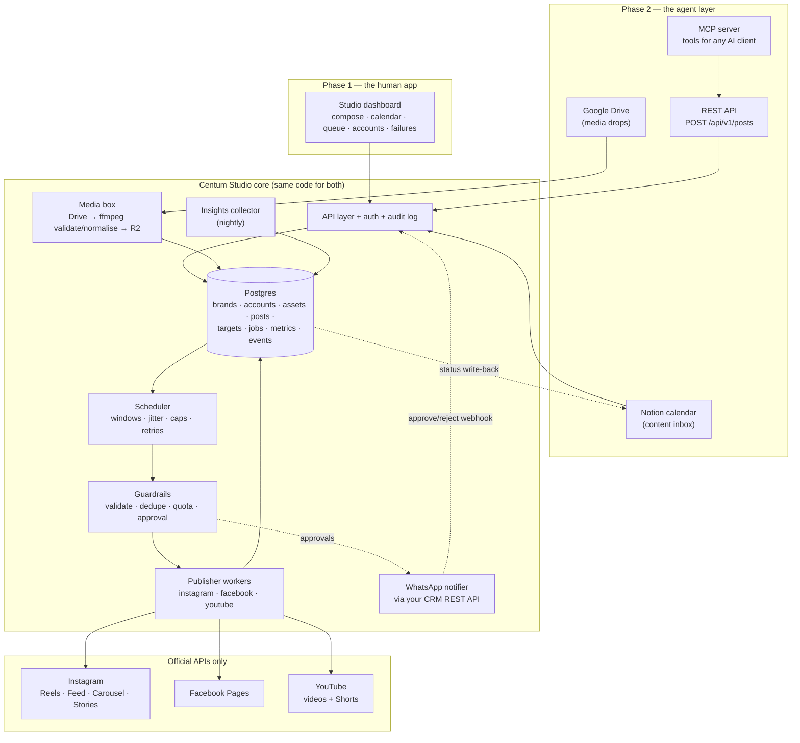

# CENTUM STUDIO — Product & Platform Plan (v2)

**A self-hosted, multi-account social publishing + scheduling app that a human runs from a dashboard and an AI agent drives through an API.**

Prepared: 15 Oct 2026 · Repo: `aakaash-dotcom/studyhub` (to be replaced) · Branch: `arena/62d3f656-studyhub`

---

## DECISIONS LOCKED (v2 — after your latest message)

| # | Decision | Value |
|---|---|---|
| 1 | **Build route** | Custom app — **Centum Studio** — on the official **Instagram / Facebook / YouTube** APIs. Free, you own everything. |
| 2 | **Phase order** | **P1: a complete human-usable app.** Sign in → connect accounts → compose → schedule → publish → see results. **P2: the agent layer** (REST API + MCP + Notion/Drive intake) on the *same* database. **P3: content factory + analytics loop.** |
| 3 | **Platforms (v1)** | **Instagram** (Reels, Feed images, Carousels, Stories) + **YouTube** (videos + Shorts). Facebook Pages = ~1 day of extra work with the same Meta app, switch on when you want. |
| 4 | **Out of scope** | TikTok ❌ · Telegram ❌ · X ❌ · LinkedIn ❌ · Threads ❌ (all revisit-able in P3). |
| 5 | **Notifications & approvals** | **Your existing WhatsApp CRM, via its REST API.** One-tap approval links, published/failed alerts, daily digest, quota + token alarms. Not a publishing target. |
| 6 | **Runtime** | Docker Compose (app + worker + Postgres + HTTPS proxy) on a small VPS or your always-on machine. A scheduler must run 24×7 — serverless free tiers can't do per-minute jobs. |

**Can I build it, or should you ask another AI model (Z/GLM/etc.)?** → See `BUILD_PLAN.md` §A. Short answer: **I'll build it here, in this repo, myself.** I write all the code, schema, adapters and UI, and I can run and preview the whole app in this sandbox. The parts only *you* can do are the Meta/Google app creations and OAuth consents, because those logins belong to you. The hard parts of a project like this are not code generation — they are platform rules, tokens, media hosting and quota — and those are exactly what these two documents nail down.

---

## 0. Executive summary

You want three things:

1. **Connect many Instagram accounts** — the tuition-centre page plus a matrix of faceless support pages for **Centum App** — and post to all of them from one place.
2. **Schedule Reels and posts** automatically, and **upload to YouTube** too.
3. **Let AI agents feed the system** — drop media in Drive, write the post spec, and have it scheduled and published with no copy-paste.

**The recommendation in one paragraph:**

> Build **Centum Studio** — a thin custom app that talks directly to the **official Instagram Graph API, Facebook Pages API and YouTube Data API** (all free), stores all content state in **one Postgres database**, mirrors media to a **public HTTPS URL on Cloudflare R2** (Meta and YouTube *fetch* media from a URL — Google Drive links do not work), and exposes the **same operations twice**: once as a **human dashboard** and once as a **REST + MCP API for agents**.

**The two findings that shape the whole build:**

- 🟢 **Instagram: you can skip Meta App Review entirely.** Keep the Meta app in *Development Mode* and add every page you own as an **Instagram Tester** — then you can publish Reels, carousels, images and Stories to all your own accounts, permanently, for free. App Review (weeks of screencasts + business verification) is only needed when *strangers* connect their accounts to your app. All pages are yours → **skip it.**
- 🔴 **YouTube: the opposite.** A fresh Google Cloud project that hasn't passed the **YouTube API compliance audit** can upload — but every video is silently locked to **Private**, with no appeal. So: submit the audit form on day one, and structure the app so YouTube publishing works in "private + `publishAt`" mode from the start (YouTube flips it public itself once you're audited).

**Never build the other kind of tool.** Browser automation / private Instagram endpoints / "engagement bots" are precisely what gets accounts action-blocked, shadowbanned or deleted. Official APIs are slower to set up and completely boring — which is the point.

---

## 1. Scope — what the app is

| Piece | Description |
|---|---|
| **Accounts & brands** | Brands (Tuition, Centum App, each faceless page) with tone, language, hashtag sets, colours, funnel link. Accounts underneath: Instagram professional accounts, YouTube channels, Facebook Pages. Connect via OAuth; tokens encrypted at rest; auto-refresh. |
| **Composer** | Human-first post builder: drag in media, write caption (Tamil/English), pick brands/accounts, set per-platform overrides (YouTube title/description/tags, Reel cover, `share_to_feed`), schedule or queue. |
| **Media box** | Upload or pull from Drive → validate with `ffprobe` → normalise with `ffmpeg` (9:16 1080×1920, H.264+AAC, faststart; PNG/HEIC→JPEG) → mirror to **R2** → public URL. |
| **Calendar & queue** | Week/month calendar, drag to reschedule, per-account posting windows with randomised jitter, daily caps, live quota view. |
| **Publisher workers** | One adapter per platform + media type. Instagram: create container → poll until `FINISHED` → publish. YouTube: resumable upload → `private` + `publishAt` → thumbnail/metadata. |
| **Approval gate** | Nothing goes public without an explicit approval or a brand marked `autopublish`. Approve in the dashboard or from a **WhatsApp** one-tap link. |
| **Failure inbox** | Every failed target with a human-readable reason and a one-click fix/retry. This screen is what makes the app trustworthy at 6 am. |
| **Notifications** | Via your WhatsApp CRM: approval requests, published/failed, daily digest, quota + token alarms. |
| **Agent layer (P2)** | REST API + MCP server exposing exactly the same operations the dashboard uses — so an agent is a *client*, never a special case. |
| **Content factory (P3)** | Templated reels/carousels for the faceless pages, question-of-the-day pipeline, long-form → Shorts clipper, TTS + captions. |
| **Analytics (P3)** | Nightly metrics from IG Insights + YouTube Data API; weekly digest; best-time and best-hook learning fed back into the factory. |

---

## 2. Platform reality check (verified Oct 2026)

### 2.1 Capability matrix

| Platform | Auto-publish? | Account requirement | App Review? | Hard blocker |
|---|---|---|---|---|
| **Instagram** — Feed, Reels, Carousel, Stories | ✅ Yes | **Business or Creator** professional account (personal = zero API access) | **No** — not for accounts you own (Development Mode + Instagram Tester role) | Media must be at a **public HTTPS URL**; feed images **JPEG only** (≤8 MB, 4:5→1.91:1); Reels need a poll loop. |
| **Facebook Pages** | ✅ Yes | Page you admin | No (own pages) | 25 posts / 24 h / Page. |
| **YouTube** — video + Shorts | ✅ With caveat | Channel via OAuth `youtube.upload` | **Yes — compliance audit** | Unaudited project uploads are locked **Private**, unappealable. |
| **WhatsApp (your CRM)** | ✅ Messaging only | Your CRM's REST API | No | Never in the publishing critical path. |

### 2.2 Instagram — the numbers that matter

| Limit | Value | Notes |
|---|---|---|
| API-published posts | **100 / rolling 24 h / account** (older docs say 25 — your account may allow less) | Carousel = **1**. Always read `GET /{ig-id}/content_publishing_limit?fields=quota_usage,config` before a batch; never hard-code. |
| Unpublished containers | **50** max in flight; a container **expires after 24 h** | Build the poll-then-publish step to finish in minutes. |
| Images | **JPEG only**, ≤ 8 MB, ratio **4:5 → 1.91:1** | PNG/HEIC must be converted (we do it in the media box). |
| Reels | MP4/MOV, H.264/HEVC + AAC, 23–60 fps, **9:16**, 3 s – 15 min, ≤ 300 MB | Reels-tab eligibility ≈ 5–90 s at 9:16. |
| Reel cover | `cover_url` (JPEG 9:16 ≤ 8 MB) or `thumb_offset` ms | Grid shows a 3:4 centre crop — keep text inside the middle. |
| Carousel | **10 items max via API** (20 only inside the app) | Anything advertising 20-slide *scheduling* is wrong. |
| Caption | 2 200 chars, 30 hashtags, 20 @mentions | URL-encode `#` in raw calls. |
| Tokens | Long-lived **60 days**, refreshable | Nightly refresh job is mandatory; alert 7 days before expiry. |
| Rate limit | Business Use Case: `4800 × impressions` calls / 24 h per account | A brand-new page has a tiny budget → cache reads, batch calls. |

**Two auth paths — choose per account, the app stores both kinds:**

| | **Instagram API with Instagram Login** ← recommended | **Instagram Graph API with Facebook Login** |
|---|---|---|
| Host | `graph.instagram.com` | `graph.facebook.com` |
| Facebook Page needed | **No** | Yes |
| Scopes | `instagram_business_basic`, `instagram_business_content_publish` | `instagram_basic`, `instagram_content_publish`, `pages_*` |
| Missing | Ads, product tagging, competitor/hashtag search | — |
| Use for | The faceless page matrix | Pages you already manage in Business Manager (adds insights/hashtag research) |

### 2.3 YouTube — the audit is the whole story

- **Quota:** 10 000 units/day per project for normal calls; uploads historically ~1 600 units (≈6/day) and per 2026 docs moved into their own **~100 uploads/day bucket** — **verify in your own project's Quotas page** before designing around it. Other costs: `thumbnails.set` 50, `captions.insert` 400, `playlistItems.insert` 50, `videos.update` 50.
- **Audit gate:** projects created after **28 July 2020** upload **private-only** until the **YouTube API Services compliance audit** passes. `privacyStatus: public` doesn't error — it just doesn't happen, and the channel gets an email. **No appeal**; affected videos must be re-uploaded.
- **Native scheduling:** upload with `status.privacyStatus = private` + `status.publishAt` (RFC 3339) and YouTube flips it public itself. (`publishAt` + `public` = error.)
- **Shorts:** same endpoint, ≤ 3 min, vertical/square. **A 9:16 1080×1920 MP4 satisfies Shorts *and* IG Reels → one master file, three platforms.**
- **Protocol:** resumable chunks in **multiples of 256 KB**; 256 GB max; title ≤ 100 chars, description ≤ 5 000 bytes, tags ≤ 500 chars.
- **Audit prep (do it now, in code):** privacy-policy + data-deletion pages on your domain, refresh-or-delete stored user data within 30 days, `selfDeclaredMadeForKids` set correctly, AI-content disclosure flags where applicable, and a demo video of the consent → publish flow.

### 2.4 WhatsApp via your CRM — notifications & approvals

| Message | Trigger | Content | Action |
|---|---|---|---|
| **Approval request** | Post enters `needs_review` | Brand, targets, scheduled time, caption excerpt, preview link | Approve / Reject → signed, single-use, 24 h one-tap link → `POST /api/webhooks/approval` → post moves to `queued` |
| **Published** | Target reaches `posted` | Live URL(s) | — |
| **Failure** | Non-retryable error or retries exhausted | Error code + plain-English reason + suggested fix | Retry / Open in Studio |
| **Daily digest** | 08:30 IST | Today's plan, yesterday's results, remaining quota | — |
| **Quota alarm** | Account at 80 % of its 24 h publishing cap | Account, used/total | — |
| **Token alarm** | Token expires < 7 days and auto-refresh failed | Account, expiry | Reconnect deep link |

**Rules:** all outbound WhatsApp goes through your CRM's REST API behind a single `notifier` interface (`sendTemplate`, `sendText`) — swapping providers later is one file. **The CRM is never in the publishing path:** if it's down, posts still publish; you just don't get the ping. Inbound webhooks land on one `/api/webhooks/*` router.

---

## 3. Build vs. borrow

| | **A. Self-host Postiz / Mixpost** | **B. Rent a unified API** (Blotato / Ayrshare / Upload-Post) | **C. Build Centum Studio** ← *chosen* |
|---|---|---|---|
| Cost | Server only (~₹450/mo) | $24–$149/mo | Hosting only (~₹0–500/mo) |
| Time to first post | Days (Docker + Postgres + Redis + Temporal + per-provider approvals) | **Hours** | 1–3 weeks to P1 |
| Platform quirks | ✅ Handled | ✅ Handled (incl. audits) | ❌ You own them — this doc maps them |
| Human dashboard | ✅ Polished | ✅ | ✅ Ours, shaped to your brands |
| Multi-account matrix + per-page rules | Partial | Partial | ✅ Exactly your model |
| Agent API / MCP | Postiz has one | Some have MCP | ✅ Yours, same code paths as the UI |
| Content factory for faceless pages | ❌ | ❌ | ✅ The real differentiator |
| Vendor risk | You patch AGPL software | Price scales with accounts; you own no tokens | You own everything |

**Why C:** the parts you care about — WhatsApp approvals, Centum App funnels, a page matrix with per-page rules, Tamil content templates, agent-friendly intake — are the parts no off-the-shelf tool does. Posting is the easy 20 %.

**Steal, don't reinvent:** mirror **Postiz's provider architecture** (one adapter per platform, uniform result type, per-provider error taxonomy) and its self-host Docker layout. Postiz stays a *reference*, not a dependency.

**Hedge worth keeping:** if you want a live post *this week*, buy one month of **Blotato (₹~2 500)** or use **Upload-Post's free tier** and route YouTube through it while your Google audit is pending. The Studio's transport layer will be swappable per platform so this is a config change, not a rewrite.

---

## 4. Architecture



### 4.1 Component notes

**Media box (the piece everyone forgets).** Meta fetches your media from a URL *you* host; Drive share links fail with *"Media download has failed"* — the single most common failure in DIY builds. So: Drive/upload → `ffprobe` validate (ratio, duration, codec, size) → `ffmpeg` normalise (1080×1920, H.264 + AAC, faststart; PNG/HEIC→JPEG) → upload to **R2** at a random immutable path → store the public URL on the post. Keep files ≥ 30 days (retries + YouTube's data rules), then lifecycle-expire.

**Scheduler.** One Postgres `jobs` table (`run_at`, `state`, `attempts`, `locked_by`) — no Redis/Temporal at your volume. Every job is idempotent on `(post_id, platform)`, so retries can never double-post. Per-account posting windows ("TN school audience: 7–9 am, 4–6 pm, 8:30–10 pm IST") with randomised ±jitter so eight pages never fire at the same second.

**Publisher workers.** Instagram container flow: create → poll `status_code` until `FINISHED` → `media_publish`. All platform errors map to a taxonomy with human actions: *token expired → reconnect*, *cap hit → moved to tomorrow 7 am*, *video rejected → ratio wrong*.

**Approval gate.** P1: dashboard approve + WhatsApp one-tap link. P2: also accepts `Status = Approved` in Notion or `publish_mode: "auto"` on an API call. Per-brand `autopublish` flag. Global kill switch.

**North-star design rule:** the dashboard and the agent API call **the same service functions**. An agent is just another client — identical validation, identical guardrails, identical audit log. That's how you get one app that both a human and an AI can operate without two systems drifting apart.

---

## 5. Data model (first cut)

```
brands            id, name, slug, pillars[], tone_guide, hashtag_sets{},
                  colours, logo_url, funnel_link, target_audience, autopublish

accounts          id, brand_id, platform, handle, platform_account_id,
                  auth_path(instagram_login|facebook_login), token_type,
                  access_token(enc), refresh_token(enc), expires_at,
                  status(connected|needs_reauth|disabled),
                  posting_windows[], daily_cap, language, timezone

assets            id, source(upload|drive|generated), drive_file_id, sha256,
                  kind(image|video), r2_key, public_url, probe_json,
                  width, height, duration_s, bytes, expires_at

posts             id, brand_id, title, caption_master, hashtags[],
                  scheduled_at, state(draft|needs_review|approved|queued|
                  publishing|posted|partially_failed|failed),
                  approval_source(ui|whatsapp|notion|api), approved_by, approved_at,
                  created_by(human|agent), source_ref, campaign_id, pillar,
                  external_id (idempotency), created_at

post_targets      id, post_id, account_id, platform, caption_override,
                  hashtags_override, media_type(REEL|IMAGE|CAROUSEL|STORY|VIDEO),
                  share_to_feed, cover_url, thumb_offset_ms,
                  yt_title, yt_desc, yt_tags[], yt_category, yt_shorts(bool),
                  yt_privacy, state, remote_id, remote_url,
                  error_code, error_message, attempts, published_at,
                  metrics_fetched_at

post_assets       post_id, asset_id, position

jobs              id, post_target_id, run_at, state, attempts, locked_by,
                  last_error, created_at

metrics_post      post_target_id, date, likes, comments, saves, shares,
                  reach, plays, watch_time_s, avg_view_pct

metrics_daily     account_id, date, followers, reach, impressions,
                  profile_views, saves, shares

events            id, at, actor(human:ravi|agent:claude|system), type,
                  subject, payload            -- full audit log, append-only
```

Two rules: **tokens encrypted at rest** (AES-256-GCM, key from env, never logged) and **every state change writes an `events` row** so a 3 am failure is diagnosable at breakfast.

---

## 6. The human app (Phase 1) — screens

1. **Login** — single-user (you) to start; email + password or a magic link. Roles table already present so you can add staff later.
2. **Dashboard** — today's queue, next 7 days, failures, quota per account, "connect an account" prompt when something needs re-auth.
3. **Accounts** — connect Instagram (two auth paths), Facebook Page, YouTube channel; health, expiry countdown, per-account posting windows, daily cap, `autopublish` toggle, disconnect.
4. **Composer** — the heart. Drop media (or pick from the media box), write captions, choose brands → accounts, per-platform overrides, live previews (Reel 9:16, feed square, YouTube card), Save as draft / Needs review / Schedule / Post now.
5. **Calendar** — month + week, drag to reschedule (writes back to `scheduled_at` and rebuilds jobs), colour by brand, filter by account.
6. **Queue / Jobs** — the raw truth: what's scheduled, what's running, what failed and why.
7. **Media box** — every asset, its validation result, its public URL, its expiry.
8. **Settings** — brands, hashtag sets, posting windows, WhatsApp CRM credentials + templates, API keys (P2), audit log.

---

## 7. Costs

| Item | Free-tier path | Recommended |
|---|---|---|
| Hosting (app + worker + Postgres) | ₹0 (Supabase + Vercel free — but cron is once-a-day ❌) | **~₹450/mo** (Hetzner CX22 ≈ €4, or your own always-on PC = ₹0) |
| Media (R2) | ₹0 (10 GB storage, zero egress) | ₹0 → ~₹130/mo beyond 10 GB |
| Domain + privacy/data-deletion pages | ~₹900/yr (needed for OAuth, YouTube audit, TikTok-nothing) | same |
| Platform APIs | ₹0 | ₹0 |
| WhatsApp CRM | your existing subscription | same |
| Optional YouTube fallback while auditing | Upload-Post free tier | ₹0–₹325/mo only if kept |
| **Total** | **₹0/mo (compromised cron)** | **≈ ₹450–600/mo** |

Compare: Ayrshare ≈ ₹13 000/mo, Blotato ≈ ₹2 500/mo, most SaaS schedulers bill per connected account. This pays for itself in month one — and you keep the accounts, tokens and data.

---

## 8. Roadmap

### Phase 0 — accounts & credentials (mostly you, ~1 weekend, I guide you click by click)
- Convert every Instagram page to a **Professional (Business or Creator)** account.
- Create **one Meta app** → add **Instagram API with Instagram Login** → add each page as an **Instagram Tester** → accept invites from each page's settings.
- Create **one Google Cloud project** → enable **YouTube Data API v3** → OAuth consent screen (privacy policy URL + demo video) → `youtube.upload` credentials → **submit the compliance-audit form on day one** (longest pole in the project).
- Create **Cloudflare R2** bucket + API token; buy/point a **domain**.
- Get your **WhatsApp CRM's REST API** base URL, auth method, and template/message endpoint (see `BUILD_PLAN.md` §F).

### Phase 1 — the human app *(I build; your first real post inside days of Phase 0)*
- Repo wiped & re-scaffolded; old study-library code archived.
- Postgres schema + encrypted token store + audit log.
- OAuth connect flows for Instagram (both paths), Facebook Pages, Google/YouTube + nightly token refresh.
- Media box: upload + Drive pull → ffmpeg validate/normalise → R2 → public URL.
- Publishers: **IG Reel, IG image, IG carousel, IG Story** and **YouTube video/Short** (resumable upload, `private` + `publishAt`, thumbnail, metadata).
- Scheduler: windows, jitter, retries, idempotency, quota guard.
- Dashboard: the 8 screens above.
- WhatsApp notifier: approvals, alerts, digest.
- Privacy + data-deletion pages, audit log, runbook. **Exit test: you schedule a Reel and a Short from the dashboard and both go live unattended.**

### Phase 2 — the agent layer *(same database, same service layer)*
- REST API (`/api/v1/posts`, `/queue`, `/assets`, `/metrics`) with per-brand keys + scopes.
- **MCP server**: `list_brands`, `list_accounts_with_quota`, `upload_media_from_drive`, `create_post`, `schedule_post`, `reschedule_post`, `cancel_post`, `get_queue`, `get_post_status`, `get_metrics`, `propose_content_plan`.
- **Notion intake + status write-back** (the Content Calendar database — schema in `BUILD_PLAN.md` §E).
- **Drive drop** conventions with caption sidecars.
- Agent safety rails: approval-by-default, rate limits, provenance tagging, kill switch.
- **Exit test: an agent (me) queues a week of content from a plan and you approve it from WhatsApp.**

### Phase 3 — content factory & analytics
- Template reels (Remotion/ffmpeg), question-of-the-day pipeline from your TN syllabus catalogue, carousel generator.
- Long-form → Shorts clipper; TTS voiceover; burned-in Tamil/English captions.
- Insights collector + weekly digest + best-time/best-hook learning; per-page funnel/UTM tracking into Centum App.
- Optional: Facebook Pages enable, Threads, multi-tenant mode if other tuition centres want the tool.

---

## 9. Idea vault — 40 ways to make this compound

**Content supply** — 1) Question-of-the-day generator (365 posts/page/yr from a spreadsheet). 2) "1 mark in 60 seconds" micro-lessons. 3) Samacheer chapter-map reels, one per chapter. 4) Previous-year papers → "PYP Wednesday" with answer reveal. 5) Common-mistakes series (highest saves). 6) Formula-sheet carousels, one subject per week. 7) Diagram-drawing reels (Bio/Geography). 8) Tamil-medium ↔ English-medium twin pages, same content. 9) Auto exam-countdown posts (X days to 10th/12th boards). 10) Pre-built results-day & admission-season packs. 11) Topper-tips clips from your own students. 12) Doubt-of-the-day: turn real student comments into a reel. 13) Parents' Corner page (study habits, screen time) — different audience, same funnel. 14) Teacher-spotlight series cross-posted to the tuition page. 15) Live class → 5–8 shorts per session.

**Growth** — 16) Collab posts between the tuition page and Centum page. 17) Comment-bait: "answer in comments, solution at 9 pm". 18) Save-bait formats (full chapter revision sheets). 19) Numbered series ("Q47/365") to create return visits. 20) Rotating per-page hashtag sets kept in one place. 21) Best-time learning from your own data after 4 weeks. 22) Story → Reel loop teasing each reel. 23) Pinned "Start here" post per page. 24) Cross-page shoutouts, deliberately staggered. 25) WhatsApp-channel mirror of every post (via your CRM) at zero extra cost.

**Product & money** — 26) Centum App install funnel with UTM-tagged links per page. 27) Comment-to-DM lead magnets ("comment MATERIAL" → auto-send a PDF). 28) Exam-specific lead magnets (10th Maths one-mark bank, 12th Bio diagram pack). 29) Google Business Profile posts for the tuition centre (competitors forget this). 30) YouTube long-form for monetisation + Shorts for discovery. 31) Testimonial miner from result-day messages. 32) Sponsor-ready analytics if a page takes off. 33) Sell the tooling later to other TN coaching centres.

**Operations** — 34) Weekly performance digest to WhatsApp. 35) Auto-retire formats that lose 5× in a row. 36) A/B flags on hooks and covers with a winner report. 37) Calendar heatmap to spot content gaps early. 38) Approve everything from your phone via WhatsApp. 39) Nightly export/backup of posts, captions and metrics — never depend on one platform. 40) Agent memory: store which hooks performed for which audience so the next batch is written with that context (this is what makes the agent layer compound).

---

## 10. Open questions (answer whenever; safe defaults in brackets)

1. **Runtime** — small VPS (~₹450/mo, recommended) · your own always-on PC (₹0) · free tier (₹0 but cron/hourly, not per-minute).
2. **How many pages** in the first batch? (Affects Meta tester invites and cap planning — default: tuition + Centum + 3 faceless.)
3. **Instagram auth path** — pure **Instagram Login** for all (recommended, simplest) or add Facebook Login for the pages already in Business Manager?
4. **YouTube during the audit** — upload as Private + `publishAt` and wait for the audit (recommended), or route YouTube through a rented API meanwhile?
5. **WhatsApp CRM** — which one is it (provider name), and does it expose (a) send-message, (b) template messages, (c) webhooks/inbound? I'll write the adapter to whatever it offers.
6. **Old repo** — I'll archive the study-library app to `legacy/` (especially `src/data/catalogue.json`, which is a reusable TN syllabus catalogue that can seed the question-of-the-day pipeline) and delete everything else. Say the word if you'd rather keep nothing at all.

---

## 11. Repo plan

```
studyhub/                          ← same repo, new project
├─ PLAN.md                         ← this document
├─ BUILD_PLAN.md                   ← build order, stack, sprints, credential checklists
├─ legacy/                         ← archived old app (or a git tag, your call)
├─ docker-compose.yml              ← app · worker · postgres · caddy
├─ apps/
│  ├─ studio/                      ← Next.js dashboard (compose, calendar, queue, accounts, failures)
│  ├─ api/                         ← REST + MCP + OAuth callbacks + webhooks
│  └─ worker/                      ← scheduler, publisher adapters, media box, insights
├─ packages/
│  ├─ core/                        ← schema, types, job logic, quota, guardrails
│  ├─ providers/                   ← instagram · facebook · youtube  (+ transport override hooks)
│  ├─ media/                       ← drive client, R2 client, ffmpeg validate/normalise
│  ├─ notify/                      ← WhatsApp CRM adapter behind the `notifier` interface
│  ├─ notion/                      ← P2 content-calendar sync
│  └─ render/                      ← P3 Remotion templates + generators
├─ docs/                           ← setup guides, platform checklists, audit prep, runbook
└─ .env.example                    ← every key, documented
```

---

## Appendix A — sources (verified Oct 2026)

- **Instagram/Meta:** developers.facebook.com/docs/instagram-platform/content-publishing · IG User Media reference (Reels specs, covers, carousels) · Instagram API with Instagram Login · App Roles / Development-Mode tester publishing · `content_publishing_limit` endpoint.
- **YouTube:** developers.google.com/youtube/v3/docs/videos (`videos.insert` private-restriction note) · getting-started quota units + 2026 granular buckets · YouTube API Services Audit & Quota Extension form · resumable-upload protocol and metadata limits.
- **Tools surveyed:** Postiz (AGPL-3.0, self-host, 30+ platforms, API+MCP — reference architecture) · Mixpost (Laravel, Lite free / Pro $299) · n8n community workflows (Drive→IG/YT, Notion calendars) · Blotato ($29/mo) · Ayrshare ($149+) · Upload-Post (free tier) · Buffer API.
- **Infrastructure:** Cloudflare R2 pricing (10 GB free, zero egress) · Supabase free tier (1 GB, 7-day pause) · Remotion + open-source render alternatives (Motion Canvas, Revideo, ffmpeg) for Phase 3.
- **Risk:** Instagram multi-account enforcement analyses (IP clustering, duplicated-content detection) — the basis for the "official API + staggered windows + per-page identity + approval gate" rules.
